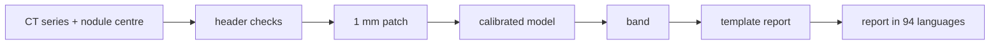
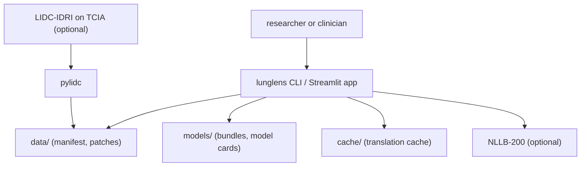
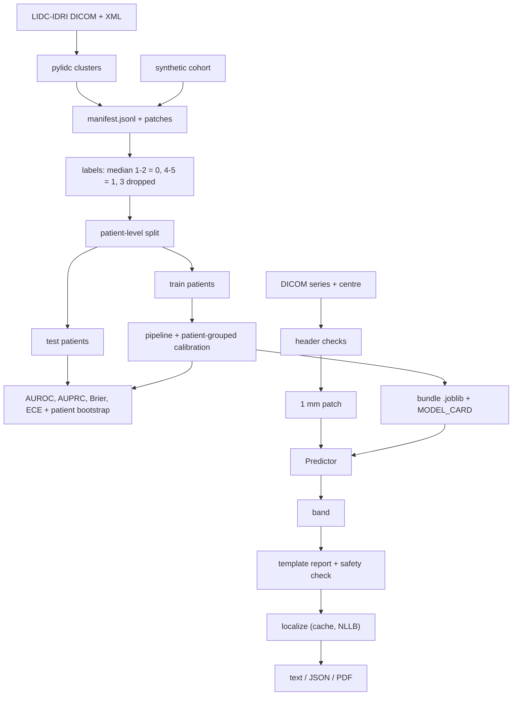

<div align="center">

# lunglens — Lung Nodule Malignancy Estimates With Multilingual Reports

**lunglens is a research tool for one marked lung nodule on a chest CT. It takes a nodule patch through these steps to a calibrated estimate and a fixed-template report in 94 languages:**

`validate` → `extract patch` → `estimate` → `calibrate` → `band` → `report` → `localize`.


**[Summary](#1-summary)** ·
**[Workflow](#4-the-end-to-end-workflow)** ·
**[Run it](#10-how-to-run-lunglens)** ·
**[Configuration](#104-environment-variables)** ·
**[Known problems](#13-known-problems)** ·
**[Glossary](#15-glossary)**

</div>

> [!NOTE]
> This README uses ASD-STE100 Simplified Technical English. The writing rules and the project
> vocabulary are in [`docs/ste-style-guide.md`](docs/ste-style-guide.md). Each term in the
> [Glossary](#15-glossary) has only one meaning.

> [!WARNING]
> Do not use lunglens to make a medical decision. It is research software, not a medical device.
> A radiologist or a doctor must review every scan and every result.

---

lunglens gives a malignancy estimate for one lung nodule that a person marked on a chest CT. The label of each nodule comes from the ratings of the readers who marked that nodule. The test set has only patients that the model did not see. The patient report uses fixed, reviewed sentences. A translator changes only those sentences, and the numbers go back into them after translation.

This README is the **one location that explains all of lunglens**. It gives these topics:

- the general design
- each component and its procedure, step by step
- the decision rules
- the data map
- the runbook
- the validation results and the known problems

| If you are… | Read |
|---|---|
| A manager or reviewer | [1](#1-summary), [3](#3-design-rules), [4](#4-the-end-to-end-workflow), [12](#12-validation-results), [14](#14-key-points) |
| A developer who joins the project | All sections, in sequence. Keep [10](#10-how-to-run-lunglens) and [13](#13-known-problems) open while you work |
| An operator who runs lunglens | [10](#10-how-to-run-lunglens), then the section for the component that you use |

---

## Table of contents

1. 🧭 [Summary](#1-summary)
2. 🏗️ [How lunglens is built](#2-how-lunglens-is-built)
   - 2.1 [Components](#21-components)
   - 2.2 [System context](#22-system-context)
   - 2.3 [Repository layout](#23-repository-layout)
3. 🛡️ [Design rules](#3-design-rules)
4. 🔄 [The end-to-end workflow](#4-the-end-to-end-workflow)
   - 4.1 [Full flow](#41-full-flow)
   - 4.2 [The life cycle of one nodule](#42-the-life-cycle-of-one-nodule)
5. 🔵 [Data, labels and the patient-level split](#5-data-labels-and-the-patient-level-split)
6. 🟢 [Models, calibration and evaluation](#6-models-calibration-and-evaluation)
7. 🟣 [Report, translation and questions](#7-report-translation-and-questions)
8. ⚖️ [The bands and the safety model](#8-the-bands-and-the-safety-model)
9. 🗂️ [Data and file map](#9-data-and-file-map)
10. ▶️ [How to run lunglens](#10-how-to-run-lunglens)
    - 10.1 [Prerequisites](#101-prerequisites) · 10.2 [Installation](#102-installation) · 10.3 [Run lunglens](#103-run-lunglens) · 10.4 [Environment variables](#104-environment-variables)
11. 🧩 [How to extend lunglens](#11-how-to-extend-lunglens)
12. ✅ [Validation results](#12-validation-results)
13. ⚠️ [Known problems](#13-known-problems)
14. 📌 [Key points](#14-key-points)
15. 📖 [Glossary](#15-glossary)
16. 📄 [License](#16-license)

---

## 1. Summary

**The problem.** A model that sees slices of the same patient in training and in test learns the patient, not the nodule. A safe patient tool must also answer these questions:

- Does the label describe the nodule in the image, or only the patient?
- Is the output a calibrated probability, or only a number?
- Does the report give a diagnosis or false comfort?
- Is each translation in the correct language, and does it keep the numbers?

lunglens gives each of these questions its own component. The data step labels nodules, the split step separates patients, and the report step uses fixed templates with a safety check.

| Item | Value |
|---|---|
| Input | A DICOM CT series and a nodule centre, or a 32 x 32 x 32 HU patch (`.npy`) |
| Output | Estimate, band, diameter, report text (94 languages), optional PDF, model card |
| Components | **7**: data and splits, preprocessing, features and models, evaluation, report, translation, FAQ |
| Providers | NLLB-200 through `transformers` (optional), PyTorch (optional), pylidc (optional) |
| Offline mode | Synthetic cohort, three scikit-learn models, evaluation, English reports, FAQ |
| Safety | Fixed templates, a safety notice first and last, a banned-phrase check, DICOM header checks |
| Tests | **43** unit tests pass and **1** skips locally. In CI (no torch) **42** pass and **2** skip |



---

## 2. How lunglens is built

### 2.1 Components

| Component | Module | Purpose |
|---|---|---|
| Settings | `src/lunglens/config.py` | Read and check environment variables |
| Records | `src/lunglens/data/schemas.py` | `NoduleRecord`, consensus, label rule (no 0 rating) |
| Manifest | `src/lunglens/data/manifest.py` | Read, validate and write the JSONL manifest, load patches |
| LIDC extraction | `src/lunglens/data/lidc.py` | pylidc clusters to patches and records (optional extra) |
| Synthetic cohort | `src/lunglens/data/synthetic.py` | Seeded fake patches with multi-reader ratings |
| Splits | `src/lunglens/data/splits.py` | Patient-level split, patient-grouped folds, leakage guard |
| Preprocessing | `src/lunglens/preprocess.py` | Resample to 1 mm, cut the patch, one fixed HU window |
| Features | `src/lunglens/features.py` | 8 shape and density features as a scikit-learn transformer |
| Classical models | `src/lunglens/models/classical.py` | `prior`, `size`, `radiomics` pipelines with calibration |
| 3-D CNN | `src/lunglens/models/cnn3d.py` | Small 3-D CNN, lazy torch import, same calibration |
| Evaluation | `src/lunglens/evaluate.py` | AUROC, AUPRC, Brier, ECE, patient bootstrap, reader reference |
| Pipeline | `src/lunglens/pipeline.py` | Train, evaluate, save bundle and model card, `Predictor` |
| Bands | `src/lunglens/risk.py` | Estimate to band |
| Input checks | `src/lunglens/validation.py` | Refuse screenshots, check DICOM header, read a series |
| Report | `src/lunglens/report/` | Fixed templates, banned-phrase check, optional PDF |
| Translation | `src/lunglens/i18n/` | 94 FLORES-200 codes, translators, cache, `localize()` |
| FAQ | `src/lunglens/qa.py` | Normalized matching to reviewed answers |
| CLI | `src/lunglens/cli.py` | The `lunglens` command |
| App | `src/lunglens/app/streamlit_app.py` | Optional Streamlit front end |

### 2.2 System context



### 2.3 Repository layout

```
lunglens/
├── src/lunglens/
│   ├── config.py          settings from environment variables
│   ├── preprocess.py      resample, patch, HU window
│   ├── features.py        shape and density features
│   ├── evaluate.py        metrics, bootstrap, reader reference
│   ├── pipeline.py        train, evaluate, model card, Predictor
│   ├── risk.py            bands
│   ├── validation.py      input and DICOM header checks
│   ├── qa.py              FAQ matching
│   ├── cli.py             lunglens command
│   ├── data/              schemas, manifest, lidc, synthetic, splits
│   ├── models/            classical.py, cnn3d.py
│   ├── report/            templates.json, builder.py, pdf.py
│   ├── i18n/              languages.py, translator.py
│   └── app/               streamlit_app.py
├── data/README.md         data sources, licence, manifest rules
├── docs/ste-style-guide.md
├── tests/                 pytest suite (offline)
└── .github/workflows/ci.yml
```

---

## 3. Design rules

### 3.1 One record is one nodule
`lidc.py` turns each pylidc annotation cluster into one record. The label comes from the ratings of that nodule only. A slice with no nodule never gets a label.

### 3.2 Only patients that the model did not see are in the test set
`splits.py` uses `GroupShuffleSplit` and `StratifiedGroupKFold` with the patient as the group. `assert_no_patient_overlap()` stops the run if a patient is on two sides.

### 3.3 The output is a calibrated probability
`fit_calibrated()` wraps each model in `CalibratedClassifierCV`. The calibration folds are patient-grouped folds of the training set. The report shows the Brier score and the ECE for each model.

### 3.4 One preprocessing path
Training and inference call the same `extract_patch()` and `window()` in `preprocess.py`. There is no device-dependent normalization.

### 3.5 The header decides, not the picture
`validation.py` refuses PNG, JPG and other picture files. A series must have `Modality = CT`, a chest body part (or a warning if the field is empty) and the fields that HU needs.

### 3.6 Fixed text only
The report has no generated text. Each sentence comes from `report/templates.json`. `check_safe()` refuses a report with a banned phrase, for example `great job` or `you do not have cancer`.

### 3.7 Translation keeps the numbers
`localize()` replaces each `{slot}` with a numbered marker before translation. If the translation loses a marker, the English sentence is used and the report says that it is not fully translated.

---

## 4. The end-to-end workflow

### 4.1 Full flow



### 4.2 The life cycle of one nodule

1. A person gives a CT series and the nodule centre in voxel indices.
2. `check_input_path()` refuses picture files.
3. `load_dicom_series()` reads the slices, sorts them by position and calculates HU.
4. `check_metadata()` checks the modality, the body part and the HU fields.
5. `extract_patch()` resamples to 1 mm and cuts a 32 mm cube around the centre.
6. `check_patch()` refuses a patch that is not in HU.
7. The `Predictor` gives the calibrated estimate and the measured diameter.
8. `band_for()` puts the estimate in a band.
9. `build_report()` fills the templates and runs the safety check.
10. `localize()` translates each sentence once, through the cache.

---

## 5. Data, labels and the patient-level split

**Purpose.** Make one labelled record for each nodule and keep patients apart.

| Input | Output |
|---|---|
| LIDC-IDRI scans (pylidc) or the synthetic cohort | `manifest.jsonl`, `patches/*.npy`, train and test index arrays |

**Procedure**

1. For each scan, get the annotation clusters with pylidc.
2. Keep clusters with `min_readers` or more readers.
3. Convert the scan to a (z, y, x) HU volume and cut a patch around the mean centroid.
4. Write one record with the rating of each reader and the mean diameter.
5. Calculate the consensus (median). Give label 1 for 4-5 and label 0 for 1-2. Drop 3.
6. Split by patient: 25% of patients go to the test set.
7. Make patient-grouped, stratified folds inside the training set for calibration.

**Rules**

- A rating must be 1, 2, 3, 4 or 5. A rating of 0 is refused.
- A `patient_id` must be `LIDC-IDRI-NNNN` or `SYN-NNNN`.
- A manifest with a bad line stops with `ManifestError` and the line number.

---

## 6. Models, calibration and evaluation

**Purpose.** Fit the models on training patients, calibrate them and measure them on test patients.

| Input | Output |
|---|---|
| Labelled patches and patient ids | `lunglens-<kind>.joblib`, `lunglens-<kind>.metrics.json`, `MODEL_CARD-<kind>.md` |

| Kind | Inputs | Classifier | Extra |
|---|---|---|---|
| `prior` | none | `DummyClassifier(strategy="prior")` | - |
| `size` | equivalent diameter | scaler + logistic regression | - |
| `radiomics` | 8 features (volume, equivalent diameter, maximum extent, mean HU, HU spread, calcified fraction, sphericity, margin gradient) | scaler + logistic regression (`C=0.5`) | - |
| `cnn3d` | windowed patch | 3 conv blocks, global pooling, dropout 0.3, random flips | `deep` |

**Procedure**

1. Fit each kind on the same training patients.
2. Calibrate with `CalibratedClassifierCV(method="sigmoid")` on patient-grouped folds (5 folds, 3 for `cnn3d`).
3. Predict the test patches.
4. Calculate nodule metrics: AUROC, AUPRC, Brier score, ECE (10 bins), sensitivity and specificity at 0.5.
5. Calculate patient metrics: label = any malignant nodule, score = highest nodule estimate.
6. Resample test patients 1000 times for 95% intervals of AUROC, AUPRC and Brier score.
7. Calculate the reader reference: each reader against the median of the other readers.
8. Save the bundle, the metrics and the model card.

**Rules**

- The feature transformer has no learned state. The scaler and the classifier see only training patients.
- The seed (default 13) controls the split, the folds, the models and the bootstrap.

---

## 7. Report, translation and questions

**Purpose.** Give a clear, safe and translated explanation, and answer follow-up questions.

| Input | Output |
|---|---|
| Band, estimate, diameter, position, warnings, language code | `Report` (lines, `fully_translated`), text, JSON or PDF |

**Procedure**

1. Check the language code against the list of 94 FLORES-200 codes.
2. Select the templates: title, safety notice, position, estimate, band, size, warnings, limits, next steps, safety notice.
3. For each template, replace the slots with numbered markers.
4. Translate the sentence through the cache. The NLLB translator sets `tokenizer.src_lang` for each call.
5. Put the numbers back. If a marker is lost, use the English sentence.
6. Run `check_safe()` on the full text.
7. For a question: translate it to English from its own language, match it to the FAQ, then translate the answer.

| Translator | When | Behaviour |
|---|---|---|
| `IdentityTranslator` | `LUNGLENS_TRANSLATOR=none` (default) | English text. The report is marked as not fully translated |
| `CachedTranslator(NLLBTranslator)` | `LUNGLENS_TRANSLATOR=nllb` | Each string is translated once per language and stored in `cache/translations.json` |
| `TagTranslator` | Tests and demo | Adds `[code]` to show the flow. Not a real translation |

**Rules**

- At start-up, `NLLBTranslator` checks that the tokenizer knows every code.
- The FAQ match uses casefolded, normalized text on both sides. A score below 0.6 gives the fixed fallback answer.

---

## 8. The bands and the safety model

| Band | Rule (defaults) | Report sentence |
|---|---|---|
| `lower` | estimate < `LUNGLENS_BAND_LOW` (0.15) | "This estimate is in the lower band of the model (below 15%)." |
| `intermediate` | 0.15 ≤ estimate < `LUNGLENS_BAND_HIGH` (0.50) | "... intermediate band of the model (from 15% to below 50%)." |
| `higher` | estimate ≥ 0.50 | "... higher band of the model (50% or above)." |
| `not_assessed` | The input failed a check | "The model did not give an estimate, because the input did not pass the checks." |

| Check | Value | Module |
|---|---|---|
| Modality | Must be `CT` | `validation.py` |
| Body part | `CHEST`, `LUNG`, `THORAX`, `CHEST_TO_PELVIS`. Empty gives a warning | `validation.py` |
| Slice thickness | Above 3.0 mm gives a warning | `validation.py` |
| HU fields | `PixelSpacing`, `RescaleSlope`, `RescaleIntercept` must be present | `validation.py` |
| Patch | 32 x 32 x 32, finite, -2000 to 4000, value range 50 or more | `preprocess.py` |
| Banned phrases | 10 phrases, for example `great job`, `you have cancer`, `nothing to worry` | `report/builder.py` |
| Exit codes | 0 = estimate, 2 = usage error, 4 = `not_assessed` | `cli.py` |

The band limits are research settings. They are not clinical thresholds and they are not Lung-RADS categories.

---

## 9. Data and file map

| Path | Committed? | Contents |
|---|---|---|
| `src/lunglens/report/templates.json` | Yes | The English report sentences |
| `data/README.md` | Yes | Sources, licence, manifest rules |
| `data/synthetic/`, `data/lidc/` | No (git ignores it) | `manifest.jsonl` and `patches/*.npy` |
| `models/lunglens-<kind>.joblib` | No (git ignores it) | Model bundle: model, training info, metrics |
| `models/lunglens-<kind>.metrics.json` | No (git ignores it) | Info and metrics as JSON |
| `models/MODEL_CARD-<kind>.md` | No (git ignores it) | Model card |
| `cache/translations.json` | No (git ignores it) | Translation cache |
| `*.dcm`, `*.npy`, `*.pdf`, `*.pth` | No (git ignores it) | Scans, patches, reports, weights |
| `.env` | No (git ignores it) | Local settings |

---

## 10. How to run lunglens

### 10.1 Prerequisites

| Need | For |
|---|---|
| Python 3.11+ | All components |
| `lidc` extra and the LIDC-IDRI download | `extract-lidc` |
| `dicom` extra | `predict --dicom` |
| `deep` extra | `--models cnn3d` |
| `translate` extra (about 2.5 GB model download) | `LUNGLENS_TRANSLATOR=nllb`, `i18n-build` |
| `pdf` extra | `predict --pdf` |
| `app` extra | The Streamlit app |

### 10.2 Installation

```bash
git clone https://github.com/KrishnaAnnavaram/lunglens.git
cd lunglens
python -m venv .venv
. .venv/bin/activate            # Windows: .venv\Scripts\activate
pip install -e ".[dev]"
```

### 10.3 Run lunglens

Offline demo (synthetic data, no download):

```bash
lunglens demo --out demo_out
```

Step by step on synthetic data:

```bash
lunglens synth --out data/synthetic --patients 120
lunglens train --manifest data/synthetic/manifest.jsonl --models prior,size,radiomics --out models
lunglens predict --model models/lunglens-radiomics.joblib --patch data/synthetic/patches/SYN-0005_n0.npy
lunglens ask "What does the band mean?"
lunglens languages
```

Real data and real translation:

```bash
pip install -e ".[lidc,dicom,deep,translate,pdf]"
lunglens extract-lidc --out data/lidc --min-readers 3
lunglens train --manifest data/lidc/manifest.jsonl --models size,radiomics,cnn3d --out models
export LUNGLENS_TRANSLATOR=nllb
lunglens i18n-build --langs spa_Latn,hin_Deva,arb_Arab
lunglens predict --model models/lunglens-radiomics.joblib --dicom path/to/series --center 87,250,301 --lang spa_Latn --pdf outputs/report.pdf
streamlit run src/lunglens/app/streamlit_app.py
```

| Command | Result |
|---|---|
| `lunglens synth` | Writes a synthetic cohort |
| `lunglens extract-lidc` | Writes LIDC-IDRI patches and the manifest |
| `lunglens train` | Trains, evaluates and saves models on one patient-level split, prints a table |
| `lunglens predict` | Prints the report (text or `--json`), optional PDF |
| `lunglens ask` | Answers a question from the FAQ |
| `lunglens languages` | Lists the 94 language codes |
| `lunglens i18n-build` | Fills the translation cache for the fixed texts |
| `lunglens demo` | Runs the full offline workflow |

### 10.4 Environment variables

| Variable | Used by | Meaning |
|---|---|---|
| `LUNGLENS_MODEL_DIR` | `train`, app | Model folder. Default `models` |
| `LUNGLENS_CACHE_DIR` | Translation | Cache folder. Default `cache` |
| `LUNGLENS_TRANSLATOR` | Report, FAQ | `none` (default) or `nllb` |
| `LUNGLENS_NLLB_MODEL` | Translation | Default `facebook/nllb-200-distilled-600M` |
| `LUNGLENS_SEED` | `train` | Default 13 |
| `LUNGLENS_BAND_LOW` | Bands | Default 0.15 |
| `LUNGLENS_BAND_HIGH` | Bands | Default 0.50. Must be above the low limit |

lunglens needs no credentials. Settings are in a local `.env` file. Git ignores this file.

---

## 11. How to extend lunglens

| You want to… | Do this | Code change? |
|---|---|---|
| Change the band limits | Set `LUNGLENS_BAND_LOW` and `LUNGLENS_BAND_HIGH` | No |
| Use a larger NLLB model | Set `LUNGLENS_NLLB_MODEL` | No |
| Add a language | Add its FLORES-200 code to `LANGUAGES` | Small |
| Change a report sentence | Edit `templates.json`, then get a clinical review, then run `i18n-build` again | Small |
| Add a FAQ entry | Add a `FaqEntry` to `FAQ` in `qa.py` | Small |
| Add a model | Add a pipeline to `build_pipeline()` or an estimator with `predict_proba` | Small |
| Add nodule detection | Add a detector that gives centres to `extract_patch()` | Yes |

---

## 12. Validation results

| Validation | Result | Command |
|---|---|---|
| Unit tests (local, torch installed) | **43 passed, 1 skipped** (PDF test, no `reportlab`) | `pytest -q` |
| Unit tests (CI, no torch) | 42 passed, 2 skipped (PDF test, CNN test) | `pytest -q` |
| Synthetic split | 172 training nodules (81 patients), 51 test nodules (28 other patients) | `lunglens demo` |
| `prior` (synthetic) | AUROC 0.500, Brier 0.239 | `lunglens demo` |
| `size` (synthetic) | AUROC 0.752 [0.599, 0.888], Brier 0.195, ECE 0.122, patient AUROC 0.766 | `lunglens demo` |
| `radiomics` (synthetic) | AUROC 0.829 [0.734, 0.915], AUPRC 0.757, Brier 0.167, ECE 0.119, patient AUROC 0.792 | `lunglens demo` |
| `cnn3d`, 15 epochs (synthetic) | AUROC 0.717 [0.569, 0.859], Brier 0.202, ECE 0.078 | `lunglens train ... --models size,radiomics,cnn3d` |
| Prototype R² (slice split, patient labels) | 0.987, prototype result, not reproduced here | - |

All numbers above come from synthetic patches. They show that the split, the calibration and the metrics work. They do not tell you how lunglens works on real CT scans. No LIDC-IDRI result is in this repository. The prototype R² came from a slice-level split, so slices of one patient were in training and in test. That number measures patient identity, not malignancy.

---

## 13. Known problems

Read these problems before you use lunglens in production.

| # | Area | Problem | Impact and action |
|---|---|---|---|
| 1 | Results | No result on LIDC-IDRI is in this repository or in CI | Run `extract-lidc` and `train`, and read the model card |
| 2 | Detection | There is no nodule detector. A person must give the centre | A missed nodule gets no estimate |
| 3 | Labels | Reader ratings are subjective. They are not pathology results | The label has noise. Use `--min-readers 3` for cleaner labels |
| 4 | Reader reference | The reference uses the same readers as the label | It is high on purpose. It is not a fair human benchmark |
| 5 | Bands | The band limits are not clinically validated | Do not read a band as a clinical category |
| 6 | Translation | NLLB quality differs between languages. Medical terms can be wrong | A native speaker must review each language before use |
| 7 | Bias | LIDC-IDRI has a limited set of sites and scanners | Check results by scanner, site and patient group |
| 8 | Synthetic data | The synthetic task is made by the same author as the features | Synthetic AUROC is not evidence of real performance |
| 9 | Use | lunglens is not a medical device and has no regulatory clearance | A radiologist must review each scan. Do not use it for diagnosis |

---

## 14. Key points

1. **One label for one nodule.** The label comes from the readers of that nodule, and indeterminate nodules are not used.
2. **Patients do not cross the split.** A guard stops the run if a patient is on two sides.
3. **The estimate is calibrated and measured.** Each model card gives AUROC with an interval, Brier score and ECE.
4. **The report is fixed text.** A safety check refuses reassuring or diagnostic phrases.
5. **Translation is correct and cached.** All 94 codes are FLORES-200 codes, the source language is set, and each string is translated once.
6. **Only CT series are accepted.** The DICOM header decides, not the look of a picture.

---

## 15. Glossary

| Term | Meaning |
|---|---|
| **AUROC** | Area under the ROC curve. 0.5 = chance, 1.0 = perfect ranking |
| **AUPRC** | Area under the precision-recall curve |
| **Band** | `lower`, `intermediate`, `higher` or `not_assessed` |
| **Brier score** | Mean squared error of the estimate. Lower is better |
| **Calibration** | The step that makes the output a probability that matches observed rates |
| **Consensus** | The median of the ratings of one nodule |
| **ECE** | Expected calibration error, 10 bins |
| **Estimate** | The calibrated malignancy probability for one nodule |
| **FAQ** | The fixed list of questions and reviewed answers |
| **HU** | Hounsfield units |
| **Label** | 1 (consensus 4-5) or 0 (consensus 1-2) |
| **Language code** | A FLORES-200 code, for example `spa_Latn` |
| **Manifest** | The JSONL file with one record per nodule |
| **Model card** | The file that gives the use, data, results and limits of one model |
| **Nodule** | One physical lung nodule, one pylidc annotation cluster |
| **Patch** | A 32 x 32 x 32 cube of HU values, 1 mm voxels |
| **Patient-level split** | A split where all nodules of a patient are on one side |
| **Rating** | The malignancy value of one reader, 1 to 5 |
| **Reader** | One radiologist who rated a nodule |
| **Reader reference** | AUROC of one reader against the consensus of the other readers |
| **Safety notice** | The fixed text that says the result is not a diagnosis |
| **Translation cache** | The JSON file with each translated string |

---

## 16. License

[MIT](LICENSE) © 2026 Krishna Annavaram
